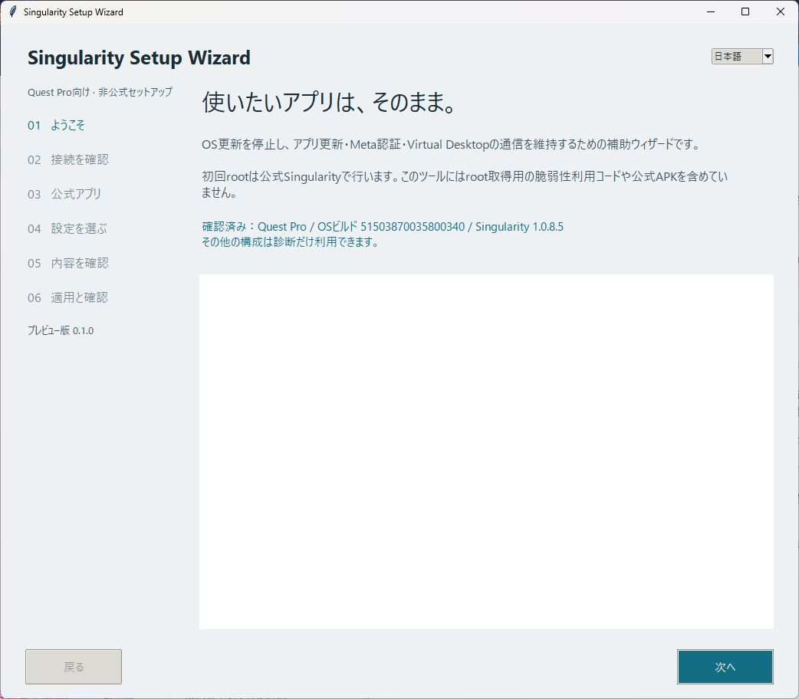

# Singularity Setup Wizard

日本語 · [English](README.md)

Quest Proの設定を案内する、**非公式の日英対応ウィザード**です。Windows版で接続・導入・設定を進め、Quest内のアプリで起動時の補助や状態確認、追加設定ができます。Lumince・Meta・Virtual Desktopの公式ツールではありません。

**プレビュー版 0.1.0。** 確認済みの構成は **Quest Pro（seacliff）/ OSビルド51503870035800340 / 公式Singularity 1.0.8.5** です。他の機種・ビルドは診断のみで、変更を適用しません。

[Windows版のダウンロード](https://github.com/r-fallingstar/singularity-setup-wizard/releases/tag/v0.1.0) · [動作確認の範囲](docs/VALIDATION.md)

## 含まれる補助ツール

| 機能 | 内容 |
| --- | --- |
| 自動rootの補助 | 公式Singularityがrootを取得した後、UID/GIDの不整合を補正。自分でrootを取得したり、自動再起動したりしません |
| OS更新の停止 | 本体更新アプリと更新エンジンを停止。アプリ更新・Meta認証・DNS・hosts・ファイアウォールは変更しません |
| ワイヤレスADBの自動接続 | 選んだQuestの識別情報で発見し、IPが変わっても再接続。Windowsログイン時の起動も選択可能 |
| スリープ設定 | 電源ボタンでのみスリープする設定、または60秒での自動スリープを選択可能 |
| 6GHz固定 | 現在接続している6GHzの電波へ固定。ルーターは変更せず、5GHzから6GHzへ移す機能ではありません |

遠隔消去・端末無効化の3項目の停止は、OS更新とは別の任意設定です。既存の一括通信遮断を自動解除する機能はありません。

## 使い方

1. Windows用ZIPを展開し、`SingularitySetupWizard.exe`を起動。日本語・英語を選びます。
2. [Google公式のPlatform Tools](https://developer.android.com/tools/releases/platform-tools)を別途導入し、必要なら`adb.exe`を選びます。
3. QuestをUSBで接続し、ヘッドセット内でUSBデバッグを許可。操作する端末を1台選びます。
4. [作者の公式配布ページ](https://github.com/Lumince/singularity/releases/tag/v1.0.8.5)からSingularity 1.0.8.5を入手します。このツールは検証済みAPKのハッシュを確認して導入します。公式APKやroot取得コードは同梱していません。
5. 公式Singularityでワイヤレスデバッグと初回rootを設定。Magiskの確認を許可します。通常の通信を使う場合はInternet Kill Switchや全体ドメイン遮断をOFFにしてください。
6. 設定を選んで内容を確認し、適用します。端末内へバックアップを保存し、独自の補助アプリとスクリプトを導入します。
7. 手動で再起動し、root状態とVirtual DesktopのPC映像を確認します。設定確認だけでは映像表示まで保証できません。
8. 必要ならPC版の結果画面でワイヤレスADBの自動接続を有効にします。スリープと6GHzはQuest版の「起動時の補助」画面で選べます。操作時に補助アプリへのMagisk許可が必要です。

Quest版のアプリIDは、従来のローカル補助アプリを上書きできるよう`com.codex.questroothelper`を維持しています。署名が違う開発者ビルドでは更新できません。SingularityのRoot on Bootを有効にしたまま、動作中の補助アプリを削除しないでください。

## 復元と制限

- PC版の復元は、このウィザードで最初に保存したSingularity設定、更新URL、対象パッケージ・コンポーネント状態を戻し、独自のOS更新停止用起動スクリプトを削除します。Magiskや補助アプリの削除、以前の別ツールの変更、任意の追加設定の解除は行いません。
- ワイヤレスADBの自動接続はPC版で停止できます。ヘッドセット側のワイヤレスADBや別ツールの接続処理は停止しません。
- スリープはQuest版で「自動スリープを60秒に設定」を選べます。これは60秒への設定で、工場出荷時の値を推測して戻す操作ではありません。
- 6GHz固定の解除は、QuestのWi-Fi設定でそのネットワークを削除し、パスワードを使って再登録します。6GHz圏外では5GHzに切り替わりません。ルーターを交換した場合も再設定が必要です。
- 更新エンジンの一時的な停止処理はroot取得後に行います。root開始前を含む全更新経路の完全な停止や、将来のOS・アプリとの互換性は保証できません。OS更新にはセキュリティー修正も含まれます。
- OS更新アプリの無効化が拒否された場合は未完了と表示します。Androidの稼働中のパッケージ管理XMLを書き換えて回避しません。途中まで適用された設定は復元ボタンで戻せます。
- root待ちは最大210秒。補助アプリは外部サーバーへ通信せず、端末内の公式root接続のみを使います。
- ワイヤレスADBは信頼できるLANで使ってください。自動接続に必要な端末識別情報とADBの場所は利用者のPC内に保存し、配布物に含めません。

開発方法は[BUILDING.md](docs/BUILDING.md)、確認範囲は[VALIDATION.md](docs/VALIDATION.md)を参照してください。独立して作成した補助ツールのライセンスはMITです。Singularity本体には作者の別のライセンスが適用されます。
