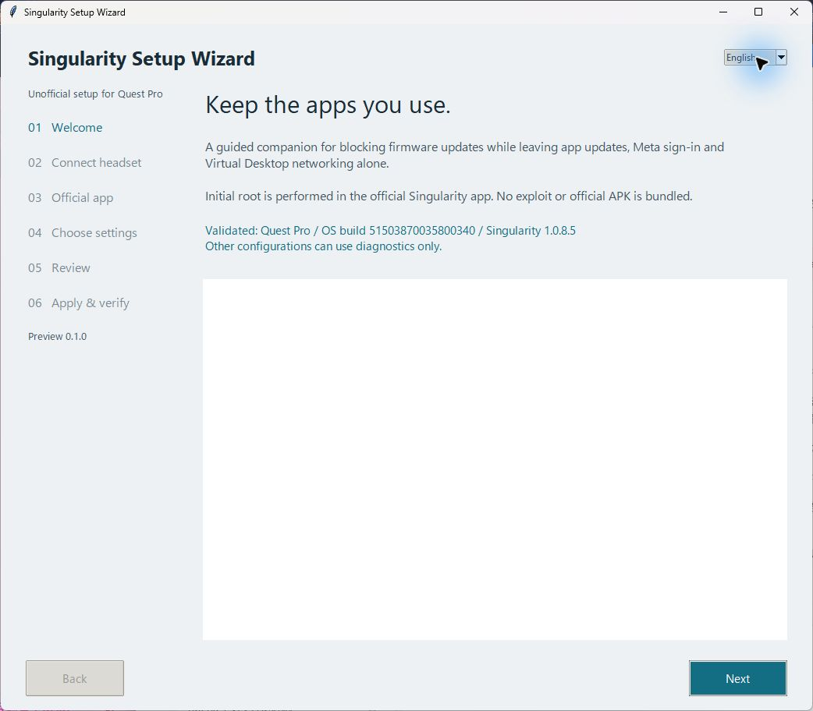

# Singularity Setup Wizard

[日本語](README.ja.md) · English

An **unofficial**, bilingual Windows + Quest companion for an already rootable Quest Pro. It guides setup of a narrow firmware-update protection profile while leaving app updates, Meta sign-in and Virtual Desktop network access alone. It is not affiliated with Lumince, Meta, or Virtual Desktop.

**Preview 0.1.0.** Validated configuration: **Quest Pro (seacliff), build 51503870035800340, official Singularity 1.0.8.5**. Other models/builds are diagnostics-only. This is not a general-purpose Quest rooting tool.

[Download the Windows preview](https://github.com/r-fallingstar/singularity-setup-wizard/releases/tag/v0.1.0) · [Validation details](docs/VALIDATION.md)



## Included helpers

| Helper | What it does | What it does not do |
| --- | --- | --- |
| Root credential repair | Normalizes UID/GID after official Singularity obtains root; runs once at boot | No exploit, firmware flashing, automatic reboot, or repeated exploit attempts |
| Firmware protection | Disables firmware updater and update engine; saves a snapshot first | Does not change app-update services, DNS, hosts, firewall rules or account services |
| Wireless ADB discovery | Finds the selected headset by its advertised ADB identity after IP changes; optional Windows sign-in startup | No LAN scanning, global ADB-server reset, or automatic pairing of other devices |
| Manual sleep | Optional Quest control: power-button-only sleep, or automatic sleep after 60 seconds | Does not force the screen awake after a power-button sleep |
| 6GHz pinning | Optional Quest control: pins the **currently connected 6GHz access point** | Does not configure your router or move a 5GHz connection to 6GHz; no 5GHz fallback while pinned |

Remote wipe/device-disable components are a separate **opt-in** setting. Existing restrictions from other tools remain intact. The app and scripts do not re-enable previously blocked Meta services or undo an existing Internet Kill Switch.

## Use

1. Download the Windows release ZIP and extract it. Start `SingularitySetupWizard.exe`. Select 日本語 or English.
2. Install [Google Android SDK Platform Tools](https://developer.android.com/tools/releases/platform-tools) separately. The wizard detects a normal SDK installation or lets you select `adb.exe`.
3. Connect the headset by USB, allow USB debugging **inside the headset**, then explicitly select the device.
4. Get **Singularity 1.0.8.5** from [the official release](https://github.com/Lumince/singularity/releases/tag/v1.0.8.5). The wizard checks the known APK SHA-256 before installing it. No official APK or exploit is included in this repository or release.
5. Complete initial wireless debugging/root in official Singularity and approve Magisk root requests. Keep Internet Kill Switch and broad domain blocking off if you want normal app connectivity.
6. Select the profile, review it and apply. The wizard installs its own companion and root helpers. Unsupported firmware and incomplete root are rejected before changes.
7. Reboot **manually**. Check root status and confirm an actual PC image in Virtual Desktop. Configuration checks alone cannot verify streaming.
8. Optionally enable automatic wireless ADB from the PC results page. Sleep and 6GHz options are under **Startup assistance** in the Quest app. Grant its Magisk request when using these controls.

The Quest application retains the legacy package ID `com.codex.questroothelper` to support in-place upgrades of the original local helper. An APK signed with a different developer key cannot update an installed copy. Do not uninstall a working root helper while Singularity Root on Boot is still enabled.

## Restore and limitations

- The PC restore button restores the wizard’s **first profile snapshot**: Singularity preferences, firmware URL settings and named package/component states. It removes this wizard’s firmware boot hook. It does not uninstall the companion, remove Magisk, undo older tools, or reverse optional sleep/6GHz/PC-startup settings.
- Stop wireless startup using the PC results page. This stops this wizard’s PC watcher, not wireless ADB on the headset or another tool’s watcher.
- For sleep, choose the 60-second automatic-sleep action in the Quest app. This is an explicit new timeout, not restoration of an unknown factory value.
- To clear a 6GHz pin, forget that Wi-Fi network in Quest settings and reconnect with its password. Changing the router hardware/BSSID requires reconfiguration.
- Root and temporary update-engine mounts exist only after official root is ready. This cannot guarantee that every update path is blocked before root starts, that root survives future OS changes, or that every Meta app works. Updates remain the vendor’s mechanism for security fixes.
- If disabling the firmware updater is denied, setup reports failure. It does **not** edit Android’s live package-restrictions XML as a workaround. Use the snapshot restore button to undo partial profile changes.
- Root-on-boot assistance waits up to 210 seconds. There is no telemetry or external server in the companion. It connects only to the official root socket on `127.0.0.1:4444`.
- Wireless ADB is intended for a trusted LAN and still requires authorization. Windows startup configuration contains a device identity and ADB path locally; these are never included in release files.

## Build and development

See [BUILDING.md](docs/BUILDING.md) and [VALIDATION.md](docs/VALIDATION.md). Source mode requires Python 3.11+ with Tk. `python desktop/run.py --preview --lang en` opens a preview that cannot change a device.

```text
python -m unittest discover -s tests -v
python android/build.py --java <JDK> --ndk <Android-NDK>
python -m pip install -r requirements-build.txt
python tools/build_windows.py
```

## Licensing

This independently written companion is MIT licensed. **Singularity is separately licensed and is not redistributed or modified here.** Its name identifies the app this tool works with. Obtain it directly from its author. Magisk, Android platform tools, Java and Android SDK/NDK are separate dependencies under their own licenses. No signing keys, ADB keys, user logs, device serials, Wi-Fi passwords or router exports belong in this repository.
